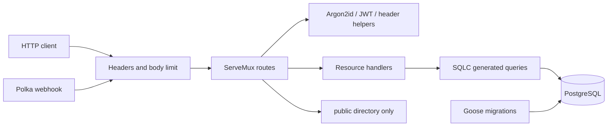

# Architecture

Threadline is a single Go service backed by PostgreSQL. It uses the standard
library HTTP router and explicit SQL rather than an ORM or web framework.

## Boundaries

`main.go` loads configuration and owns the database and HTTP lifecycle.
`router.go` builds the router, also used by `httptest` integration checks.
Handlers hold HTTP behavior; `internal/auth` has no database dependency.
`internal/database` is generated, while `sql/queries` is the source of truth.
`models.go` defines public response types so hashes stay out of JSON.

The schema preserves the course contract. User deletion cascades to posts and
refresh tokens. Refresh lookup combines user existence, token expiration, and
revocation checks in one query. Post deletion includes both post ID and owner ID.

## Resource management

A 10-connection pool with five idle connections and a 30-minute connection
lifetime bounds database usage. Startup checks connectivity with a five-second
context. HTTP header/read/write/idle timeouts are 5/15/30/60 seconds. SIGINT and
SIGTERM request a graceful shutdown, with a ten-second deadline.

Each request passes its context to database queries; disconnects and cancelled
requests can cancel database work. The public request counter is an atomic
integer and resets on restart. It is not persisted or a general metrics system.

## Feed behavior

Filtering, ordering, and LIMIT/OFFSET execute in SQL. The maximum page size is
100. Secondary indexes cover global chronology, author chronology, and refresh
ownership. PostgreSQL chooses the execution plan; the indexes do not promise a
particular latency. Large offsets still have increasing cost. Cursor pagination
and load-tested query plans are sensible next steps at larger scale.

## Why two credentials?

Access JWTs are verified using a signing secret without a database session
lookup. Their short lifetime limits how long an issued credential remains valid.
Refresh tokens are opaque random strings stored in the database, allowing the
server to revoke future renewal. This trades stateless access checks for delayed
access-token revocation. No automatic client storage or cookie behavior is
implemented by this API.
